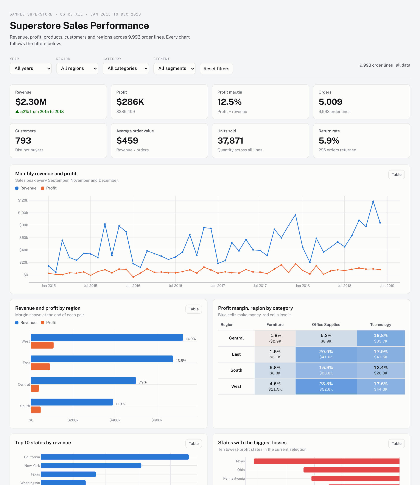

# Sales Performance Dashboard

Analysis of four years of US retail sales (Tableau's **Sample - Superstore** dataset) to find revenue
trends, top-performing products, customer purchasing behaviour and regional performance, presented in an
interactive dashboard and a business insights report.



## Headline results

| Revenue | Profit | Margin | Orders | Customers | Avg order value | Return rate |
|---|---|---|---|---|---|---|
| $2.30M | $286K | 12.5% | 5,009 | 793 | $459 | 5.9% |

* **Revenue grew 51%** from $484K (2015) to $733K (2018), a 14.9% compound annual growth rate.
* **Discounts above 20% lose money.** Those lines made $362K of revenue and lost $135K; undiscounted
  lines earn a 29.5% margin.
* **Furniture is 32% of revenue but 6% of profit.** Tables and Bookcases lose money outright.
* **Technology and Office Supplies earn 94% of profit.** Copiers return a 37% margin.
* **Central lags** at a 7.9% margin against 14.9% in the West. Texas, Ohio, Pennsylvania and Illinois lose
  $71K combined.
* **Loyal, concentrated customers.** 98% ordered more than once; the top 20% bring 48% of revenue.
* **Seasonal demand.** September to December produce 52% of annual revenue.

The full findings and recommendations are in the
[Business Insights Report (PDF)](reports/Business_Insights_Report.pdf).

## Project structure

```
Sales-Perfomance-Dashboard/
├── data/
│   ├── raw/superstore_raw.csv            original download (orders + managers + returns in one file)
│   └── processed/
│       ├── superstore_clean.csv          cleaned order lines, 33 columns (load this into Power BI / Tableau)
│       ├── regional_managers.csv
│       ├── returns.csv
│       ├── kpi_by_year.csv
│       └── customer_rfm.csv              RFM customer segmentation
├── notebooks/sales_analysis.ipynb        full analysis, executed with outputs
├── src/
│   ├── cleaning.py                       data cleaning and feature engineering
│   ├── build_dashboard.py                generates the interactive HTML dashboard
│   └── build_report.py                   generates the PDF report
├── dashboard/
│   ├── index.html                        interactive dashboard (open in a browser)
│   └── template.html                     dashboard source (layout, charts, filters)
├── powerbi/                              place the .pbix here (see docs/powerbi_tableau_guide.md)
├── docs/powerbi_tableau_guide.md         step-by-step Power BI and Tableau build, DAX measures
├── reports/Business_Insights_Report.pdf
└── images/                               chart exports used by the README and report
```

## Features

**Data cleaning and preprocessing** (`src/cleaning.py`)
* Split the flattened file into orders, regional managers and returned orders.
* Parsed dates, cast IDs and quantities, trimmed text.
* Filled 11 missing postal codes (all Burlington, VT) and removed 1 duplicate order line.
* Validated ship dates, discount range and positive sales.
* Added Year, Quarter, Month, Weekday, Days to Ship, Profit Margin, Unit Price, Discount Band,
  Returned flag and Regional Manager.

**Sales KPI analysis**: revenue, profit, margin, orders, customers, units, average order value, return
rate, year-over-year growth and CAGR.

**Interactive charts**: the dashboard filters every chart and KPI by year, region, category and segment,
shows year-over-year deltas when a year is selected, has hover tooltips, a table view for every chart,
and follows the system light or dark theme.

**Regional sales analysis**: revenue, profit and margin by region and state, region-by-category margin
heatmap, biggest loss-making states.

**Product performance**: category scorecard, sub-category profit, top and loss-making products,
Pareto concentration.

**Customer behaviour**: segment comparison, order frequency, top customers, RFM segmentation.

**Business insights**: discount impact analysis and six recommendations in the report.

## How to run

```bash
git clone https://github.com/falconboy99/Sales-Perfomance-Dashboard.git
cd Sales-Perfomance-Dashboard
pip install -r requirements.txt

python src/cleaning.py          # raw CSV -> data/processed/
jupyter notebook notebooks/sales_analysis.ipynb
python src/build_dashboard.py   # -> dashboard/index.html
python src/build_report.py      # -> reports/Business_Insights_Report.pdf
```

Open `dashboard/index.html` in any browser (it loads Plotly from a CDN, so it needs an internet
connection). To host it, enable **GitHub Pages** on the `main` branch and visit
`https://falconboy99.github.io/Sales-Perfomance-Dashboard/dashboard/`.

## Power BI / Tableau

`data/processed/superstore_clean.csv` is ready to load. Follow
[docs/powerbi_tableau_guide.md](docs/powerbi_tableau_guide.md) for the data model, DAX measures,
visual-by-visual layout and the expected totals to check your build against.

## Dataset

Sample - Superstore, published by Tableau as a public sample dataset: 9,994 order lines, 21 columns,
orders from January 2015 to December 2018 across 49 US states, three product categories, 17
sub-categories and 1,850 products. Raw file source:
[leonism/sample-superstore](https://github.com/leonism/sample-superstore).

## Tools

Python 3, pandas, NumPy, Matplotlib, Plotly.js, Jupyter, ReportLab, Power BI / Tableau.
